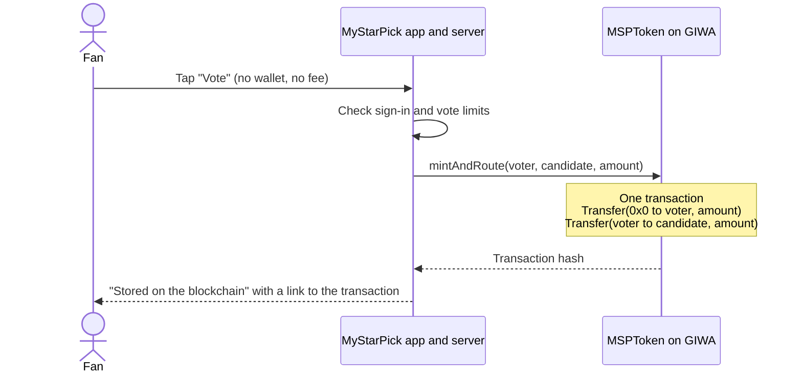

# MyStarPick Contracts

[](https://github.com/mystarpick/mystarpick-contracts/actions/workflows/ci.yml)
[](./LICENSE)

> **Reviewing this for GASOK?** Go straight to
> [Check it yourself in one minute](#check-it-yourself-in-one-minute).
> You only need a browser.

## What this is

[MyStarPick](https://mystarpick.io) is an online voting service for real contests:
pageants, auditions, awards, festivals and TV shows. Fans vote in one tap on a normal
web page or app. They need no wallet and pay no fee.

Every vote is also written to the [GIWA](https://giwa.io) blockchain as it is cast.
One vote is one token, sent to the candidate's address. This makes the result a public
record. Anyone can open it, add it up, and compare it with the result the contest
announced. Once a vote is written, nobody can edit or remove it.

This repository holds the smart contracts that do this, with their tests and
deployment scripts.

## At a glance

Snapshot from the GIWA Sepolia explorer API on **2026-11-26 03:33 KST**. The service is
live, so these numbers only go up (votes cast by reviewers are counted too).

| | |
| --- | --- |
| Votes recorded on GIWA | **439,683** (the MSP total supply, 1 token = 1 vote) |
| Vote transactions | **92,585** |
| Distinct voters | **24,048** (from the service records) |
| Real contests recorded | **18 contests** from 6 events, July to October 2026 |
| Site count vs chain count | **99.99%** of votes match, checked for all 392 candidates ([details](#3-recount-a-real-contest)) |
| Network | GIWA Sepolia, chain id 91342 |
| Contracts | 3 deployed, all source verified on the explorer |
| Tests | 28 passing (`forge test`) |
| License | MIT |

Real contests recorded on GIWA so far:

| Event | Voting period (2026) | Candidates |
| --- | --- | --- |
| [70th Miss Korea Pageant](https://mystarpick.io/2026MissKorea) | Aug 8 to Aug 22 | 26 |
| [Mister International Korea](https://mystarpick.io/2026MIK) | Aug 12 to Aug 31 | 31 |
| Best Model of Universe (13 divisions, for example [Over Ladies](https://mystarpick.io/2026BMUOverLadies)) | Jul 30 to Aug 31 | 274 |
| [Woman of the Universe](https://mystarpick.io/2026WOTU) | Sep 21 to Oct 8 | 26 |
| [Super Influencer Awards and Miss Tourism International Korea](https://mystarpick.io/2026Super) | Oct 11 to Oct 19 | 18 |
| [Supermodel International](https://mystarpick.io/2026SMI) | Oct 16 to Oct 24 | 17 |

## Check it yourself in one minute

### 1. See every vote

Open the vote token on the GIWA explorer:

<https://sepolia-explorer.giwa.io/token/0x62129f2b2B9337fa676b5B01a75de40C91221616>

- **Max total supply** is the number of votes recorded.
- The **Token transfers** tab lists every vote, newest first.
- The **Holders** tab is a live ranking. Each holder is a candidate, and the balance
  is the number of votes that candidate received.

### 2. Open one real vote

This is one fan vote from the 70th Miss Korea Pageant (August 2026, 31 votes):

<https://sepolia-explorer.giwa.io/tx/0xa6a1c6fc80c7eadc9947af183af18df0270d35c685699b49f2585079e1b0f520>

It is a single transaction with two token transfers: the votes are created for the
voter, then moved from the voter to the candidate.

### 3. Recount a real contest

The claim "anyone can check the result" is easy to test. Mister International Korea
shows its final fan vote counts on [its contest page](https://mystarpick.io/2026MIK).
Compare them with the token balances on GIWA:

| Candidate | Votes shown on mystarpick.io | Balance on GIWA |
| --- | ---: | ---: |
| Jeongchan Lee | 17,702 | [17,702](https://sepolia-explorer.giwa.io/address/0x30303fE83591b9A5143cE56a23aB841733610B86?tab=tokens) |
| Junggyu Park | 16,389 | [16,389](https://sepolia-explorer.giwa.io/address/0x3708d467c113c555c679aa7438e05feA2a866601?tab=tokens) |
| Sangmin Shin | 16,347 | [16,347](https://sepolia-explorer.giwa.io/address/0xe832AE66Cdd85B51AE2459CB7fc40E5F4fE6315a?tab=tokens) |
| Woohyuk Kim | 13,011 | [13,011](https://sepolia-explorer.giwa.io/address/0x6B91369578d4B9637bc356471d773D954c3ED4ae?tab=tokens) |
| Myeongcheol Jung | 12,577 | [12,577](https://sepolia-explorer.giwa.io/address/0xDD85437b750077293d536eFEE6508fC9FA668DEE?tab=tokens) |
| Isu Jeon | 11,715 | [11,715](https://sepolia-explorer.giwa.io/address/0x61dFed3c0F81f1f6E19Af1a3bC2eB6010682D713?tab=tokens) |

You can read a balance without the explorer too:

```bash
cast call 0x62129f2b2B9337fa676b5B01a75de40C91221616 \
  "balanceOf(address)(uint256)" 0x30303fE83591b9A5143cE56a23aB841733610B86 \
  --rpc-url https://sepolia-rpc.giwa.io
# 17702
```

We ran this comparison for **every candidate of all 18 real contests** (392
candidates) on 2026-11-26. **99.99%** of the votes shown on the site are on GIWA.

### 4. Cast a vote yourself

We keep a demo contest open for reviewers until 2026-12-31:

**<https://mystarpick.io/VNDEMO>** (change the language with the button at the top right)

Demo accounts, ready to use:

| Email | Password |
| --- | --- |
| `giwa-judge01@mystarpick.io` to `giwa-judge10@mystarpick.io` | `GiwaJudge2026!` |

1. Press **Sign In** and use one of the demo accounts.
2. Open any candidate and press **Vote**. Choose 1 to 3 votes and press **Vote** again.
   You will see "Voting details have been safely stored on the blockchain."
3. Press **View voting history** on the candidate page, or open **My Page** and then
   **Voting History**. Click the **TXID** of your vote.
4. The GIWA explorer opens and shows your vote as a transaction.

Each account gets 3 free votes a day. If an account has none left, use another one.
You can also make your own account with an email address. No phone check is needed.

To see where wallet payment will appear, press **Vote** on a candidate page and then
**Buy picks**. The **Pay with GIWA Wallet** button is under **Pay**. For now it opens a
"coming soon" notice and no payment is made (see
[Wallet payment](#wallet-payment-votingrightsgateway)).

The demo contest holds sample data for product demos, so use a real contest
([step 3](#3-recount-a-real-contest)) when you compare site counts with chain counts.

## How a vote is recorded



- Each fan and each candidate has an address on GIWA. The service creates it for them.
  A candidate address can only receive votes.
- The server holds the only key that may write votes (`MINTER_ROLE`). It calls
  `mintAndRoute` once per vote and pays the gas. The fan pays nothing.
- `MSP` has `decimals = 0`, so the numbers on chain are plain vote counts.
- A candidate's balance is the number of votes that candidate received.
- One vote costs about 50,000 to 77,000 gas.

The first version (v1) used two transactions per vote: a mint, then a transfer signed
by the fan and relayed through an ERC-2771 forwarder. Version 2 added `mintAndRoute`,
which does both steps in one transaction and keeps the same two `Transfer` events.
This halved the transactions and the gas per vote. All real contests ran on v2.

## Contracts

| Contract | Source | What it does |
| --- | --- | --- |
| `MSPToken` | [`src/MSPToken.sol`](./src/MSPToken.sol) | The vote record. ERC-20 with `decimals = 0`. Only `MINTER_ROLE` can create votes. `mintAndRoute` records one vote in one transaction. |
| `VotingRightsGateway` | [`src/VotingRightsGateway.sol`](./src/VotingRightsGateway.sol) | Wallet payment for paid votes. A fan pays from their own wallet. The gateway passes the payment straight to the treasury and records which order was paid. |
| `ERC2771Forwarder` | OpenZeppelin v5, unchanged | Lets a relayer pay gas for a transfer that a fan signed. Used by the v1 flow. Still trusted by the token. |

All contracts are built on OpenZeppelin Contracts v5.6.1.

## Deployed addresses

GIWA Sepolia, chain id **91342**. RPC `https://sepolia-rpc.giwa.io`. Explorer
`https://sepolia-explorer.giwa.io`.

| Contract | Address | Source verified |
| --- | --- | --- |
| `MSPToken` v2 (in use) | [`0x62129f2b2B9337fa676b5B01a75de40C91221616`](https://sepolia-explorer.giwa.io/address/0x62129f2b2B9337fa676b5B01a75de40C91221616) | Yes |
| `VotingRightsGateway` | [`0x100Df5a4835a6e63a2E095AC8F99743a89f97e67`](https://sepolia-explorer.giwa.io/address/0x100Df5a4835a6e63a2E095AC8F99743a89f97e67) | Yes |
| `ERC2771Forwarder` | [`0x5bFAd9AE715877e550ED9b1Eb64A62BCc90504c2`](https://sepolia-explorer.giwa.io/address/0x5bFAd9AE715877e550ED9b1Eb64A62BCc90504c2) | Yes |
| Test payment token (`GTT`) | [`0x307eFc47664f47d68C6D5867D99c30bb032d2E79`](https://sepolia-explorer.giwa.io/address/0x307eFc47664f47d68C6D5867D99c30bb032d2E79) | Yes |
| `MSPToken` v1 (retired) | [`0x3E8a08C753678E074a29384D0F8C4F8d08A00f4f`](https://sepolia-explorer.giwa.io/address/0x3E8a08C753678E074a29384D0F8C4F8d08A00f4f) | Yes |

The source shown on the explorer is the same, character for character, as the files
under the tag
[`giwa-sepolia-v2`](https://github.com/mystarpick/mystarpick-contracts/tree/giwa-sepolia-v2)
(and [`giwa-sepolia-v1`](https://github.com/mystarpick/mystarpick-contracts/tree/giwa-sepolia-v1)
for the retired token). On the `main` branch only comments have changed since then.
You can confirm that no logic changed:

```bash
git diff giwa-sepolia-v2 main -- src/
```

## Wallet payment (VotingRightsGateway)

Today fans buy extra votes by card. `VotingRightsGateway` adds a second way: a fan pays
with a stablecoin from their own wallet, such as GIWA Wallet.

- **The fan keeps control.** The fan signs the payment in their own wallet. The gateway
  sends it to the treasury in the same transaction and keeps nothing.
- **One payment per order.** Each payment carries an order reference. The same
  reference cannot be paid twice, so nobody is charged or credited twice.
- **Only approved tokens.** The owner keeps a list of accepted tokens.
- **Emergency stop.** The owner can pause new payments.

What is done and what is not:

| Item | Status |
| --- | --- |
| Contract deployed and source verified on GIWA Sepolia | Done |
| 13 tests for payment, duplicate orders, token list, pause and owner rights | Done |
| Real payments on GIWA Sepolia (below) | Done |
| Server check that turns a confirmed payment into votes | Built, tested against the two payments below |
| "Pay with GIWA Wallet" button in the app | Shown in the demo contest. For now it opens a "coming soon" notice. Real payment opens with GIWA Wallet and a real stablecoin |

Payments made through the gateway on GIWA Sepolia:

- Token payment (100 `GTT`, a test token):
  [`0xc4ef825e...c1f63b`](https://sepolia-explorer.giwa.io/tx/0xc4ef825e432d6d806b6af7ed7554b52de15a619e76dacd7efe4a0fed59c1f63b)
- Native currency payment:
  [`0x72acd538...25fc90`](https://sepolia-explorer.giwa.io/tx/0x72acd53839d33a1856d893f7039e3fd0f1574d42bc931403b30af2422225fc90)

The full design is in [docs/WALLET_PAYMENT.md](./docs/WALLET_PAYMENT.md).

## Build and test

You need [Foundry](https://book.getfoundry.sh/). The libraries are git submodules, so
clone with them:

```bash
git clone --recurse-submodules https://github.com/mystarpick/mystarpick-contracts.git
cd mystarpick-contracts
forge build
forge test -vv
```

If you cloned without submodules, run `git submodule update --init --recursive`.

The 28 tests cover:

- `MSPToken` (15): name, symbol and decimals, minting by the minter only,
  `mintAndRoute` with both events, zero address checks, plain transfers, and the
  signed transfer flow with a voter who holds no gas, including replay, bad signature
  and expired deadline.
- `VotingRightsGateway` (13): token and native payments, duplicate order rejection,
  tokens that are not accepted, zero amounts, pause, and owner only settings.

The same build and tests run on every push in
[GitHub Actions](https://github.com/mystarpick/mystarpick-contracts/actions/workflows/ci.yml).

## Deploy

```bash
cp .env.example .env      # fill in DEPLOYER_KEY, never commit .env
source .env

# Forwarder and vote token
forge script script/Deploy.s.sol:Deploy \
  --rpc-url giwa_sepolia --private-key "$DEPLOYER_KEY" \
  --broadcast --verify --verifier blockscout \
  --verifier-url https://sepolia-explorer.giwa.io/api

# Payment gateway
forge script script/DeployGateway.s.sol:DeployGateway \
  --rpc-url giwa_sepolia --private-key "$DEPLOYER_KEY" \
  --broadcast --verify --verifier blockscout \
  --verifier-url https://sepolia-explorer.giwa.io/api
```

`ADMIN_ADDRESS`, `MINTER_ADDRESS` and `TREASURY_ADDRESS` are optional. If they are not
set, the deployer gets those roles. The scripts stop before sending anything if a role
is set to the zero address.

## Versions

| Tag | What changed |
| --- | --- |
| [`giwa-sepolia-v1`](https://github.com/mystarpick/mystarpick-contracts/tree/giwa-sepolia-v1) | First deployment. Two transactions per vote (mint, then a relayed transfer signed by the fan). |
| [`giwa-sepolia-v2`](https://github.com/mystarpick/mystarpick-contracts/tree/giwa-sepolia-v2) | `mintAndRoute`: one transaction per vote. Adds `VotingRightsGateway`. This is the version in use. |

## Trust model

We want reviewers to know exactly what the chain proves and what it does not.

**What the chain proves**

- Every recorded vote exists, with its time, its amount, the voter address and the
  candidate address.
- A candidate's total is the sum of those votes. Anyone can recount it.
- A recorded vote cannot be edited or deleted. The token has no burn, no pause and no
  upgrade path.
- Votes can only be added to a candidate, never taken away. The key of a candidate
  address is thrown away when the address is created, so nobody can move votes out of
  it, and that includes us. You can see this on chain: none of the 392 candidate
  addresses of the real contests has ever sent a transaction.

**What the chain does not prove**

- It does not prove that a vote came from a unique real person. That is the job of the
  service (sign-in, vote limits per account, rate limits), not of the contract.
- Fans do not hold their own keys. The service creates and keeps an address for each
  fan, and the service writes the vote for them.
- It does not prove that every vote in the service reached the chain. The
  [recount](#3-recount-a-real-contest) is how anyone can test that.

**Who holds the power**

- Only the address with `MINTER_ROLE` can write votes, and there is no supply cap. If
  that key leaked, someone could write false votes. They would be visible to everyone
  on chain, and the admin would stop them with
  `revokeRole(MINTER_ROLE, leakedMinter)` and then grant the role to a fresh key.
- The gateway owner can pause payments, change the treasury and change the token list.
  The gateway never holds funds, so there is nothing in it to take.

**Testnet today, mainnet later**

- On GIWA Sepolia one address
  ([`0x64bf...c7F4`](https://sepolia-explorer.giwa.io/address/0x64bf0096a9489AbFc826452Ff18DDE7bdd2Ac7F4))
  is the deployer, token admin, minter, gateway owner and treasury. This is simple and
  fine for a testnet. It is not how we will run on mainnet.
- On mainnet the token admin, the gateway owner and the treasury will be a multisig.
  The minter will be a separate server key that can be revoked at any time.

## Roadmap

- **GIWA mainnet launch.** Deploy the vote token and the gateway to mainnet from `main`
  on launch day, with a multisig admin and a separate minter key.
- **Stablecoin voting in GIWA Wallet (first half of 2027).** Fans pay for votes with a
  stablecoin from GIWA Wallet through `VotingRightsGateway`.
- **More contests on GIWA (second half of 2027).** 15 or more contests outside Korea
  recorded on GIWA.

## License

[MIT](./LICENSE) © MyStarPick
