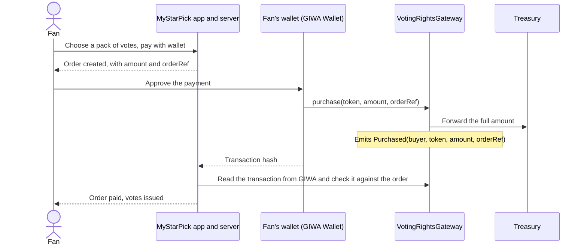

# Wallet Payment for Paid Votes

This document explains how a fan can pay for votes with a stablecoin from their own
wallet, such as GIWA Wallet. It covers the design, what is already built on GIWA
Sepolia, and what is left before it opens to fans.

For the vote record itself, see the [README](../README.md).

## The idea in three lines

1. Today fans buy extra votes by card.
2. `VotingRightsGateway` adds a second way to pay: a stablecoin, sent from the fan's own
   wallet on GIWA.
3. After the payment is confirmed on chain, the fan gets exactly the same votes as with
   a card. Voting itself does not change.

## Design rules

**The fan keeps control of the money.** The fan signs the payment in their own wallet.
MyStarPick never holds the fan's funds. The gateway sends the payment to the treasury
inside the same transaction and keeps nothing. Its balance is always zero.

**The contract has no prices.** A pack of votes has a fixed price, set by the service
when the order is created. The contract records only who paid, which token, how much,
and for which order. Keeping prices out of the contract means a price change never
needs a new deployment.

**One payment per order.** Every payment carries an order reference (`orderRef`). The
contract rejects a reference that was already paid, so a fan cannot be charged twice
and votes cannot be issued twice.

**Only approved tokens.** The owner keeps a list of accepted tokens. A token that is
not on the list is rejected, so nobody can pay with a worthless or harmful token.

**One path for issuing votes.** A wallet payment ends at the same step as a card
payment. The service already has one place that marks an order as paid and issues the
votes, with its own checks for duplicates and limits. Wallet payments reuse it.

## Flow

The service does not trust the app or the wallet to say that a payment happened. It
reads the transaction from GIWA itself. It checks that the transaction succeeded, that
the payment event came from our gateway, and that the order reference, the token and
the exact amount all match the order. Only then does it issue the votes.

The order reference is a value only the service can produce for an order, so nobody
can guess a future reference and use it up in advance.

## The contract

Source: [`src/VotingRightsGateway.sol`](../src/VotingRightsGateway.sol)

| Function | Who can call it | What it does |
| --- | --- | --- |
| `purchase(token, amount, orderRef)` | Anyone | Pays with an accepted token. The fan must approve the gateway for the amount first. |
| `purchaseNative(orderRef)` | Anyone | Pays with the native currency of the chain, if the owner has turned this on. |
| `setAcceptedToken(token, accepted)` | Owner | Adds or removes a token from the accepted list. |
| `setNativeAccepted(accepted)` | Owner | Turns native currency payments on or off. |
| `setTreasury(treasury)` | Owner | Changes the address that receives payments. |
| `pause()` / `unpause()` | Owner | Stops or resumes new payments. |

Safety properties, each covered by a test in
[`test/VotingRightsGateway.t.sol`](../test/VotingRightsGateway.t.sol):

- A used `orderRef` cannot be paid again.
- A token that is not accepted is rejected.
- A zero amount or an empty `orderRef` is rejected.
- No payment goes through while the gateway is paused.
- Only the owner can change the treasury or the token list.
- The treasury cannot be set to the zero address.
- The order is marked as paid before the money moves, and the payment functions are
  protected against reentrancy.

A freshly deployed gateway accepts nothing. The owner must add a token or turn on
native payments first.

## What is built

On GIWA Sepolia (chain id 91342):

| Piece | Where | Status |
| --- | --- | --- |
| `VotingRightsGateway` | [`0x100Df5a4835a6e63a2E095AC8F99743a89f97e67`](https://sepolia-explorer.giwa.io/address/0x100Df5a4835a6e63a2E095AC8F99743a89f97e67) | Deployed, source verified |
| Test payment token (`GTT`) | [`0x307eFc47664f47d68C6D5867D99c30bb032d2E79`](https://sepolia-explorer.giwa.io/address/0x307eFc47664f47d68C6D5867D99c30bb032d2E79) | Deployed, source verified |
| Contract tests | This repository | 13 tests passing |
| Server check of a payment | MyStarPick service | Live in the demo contest. Checks the gateway, the order reference, the token and the exact amount |
| Wallet payment in the app | [Demo contest](https://mystarpick.io/VNDEMO) | Live on the testnet with a standard browser wallet such as MetaMask |

Payments made on GIWA Sepolia:

- Payment made in the live app on 2026-11-26. A wallet paid 2 `GTT` for a pack of 10
  votes, the service confirmed it on chain, issued the votes and cast them:
  [`0xde9bba16...245f30`](https://sepolia-explorer.giwa.io/tx/0xde9bba162274156d2b72b0dc9b69a13e9617de0630e9994b8ef5f1204c245f30)
- Token payment. The fan's wallet paid 100 `GTT`, the treasury received 100 `GTT`, and
  the gateway emitted `Purchased`:
  [`0xc4ef825e...c1f63b`](https://sepolia-explorer.giwa.io/tx/0xc4ef825e432d6d806b6af7ed7554b52de15a619e76dacd7efe4a0fed59c1f63b)
- Native currency payment. The treasury received the value and the gateway emitted
  `NativePurchased`:
  [`0x72acd538...25fc90`](https://sepolia-explorer.giwa.io/tx/0x72acd53839d33a1856d893f7039e3fd0f1574d42bc931403b30af2422225fc90)

`GTT` is a test token that anyone can mint. It has no value. It stands in for a real
stablecoin until one is available on GIWA.

## What is left

Wallet payment already works end to end on the testnet, in the demo contest. Votes
bought with the test token can be used only in demo contests, never in a real one.
These steps remain before fans can use it in real contests:

1. **A real stablecoin on GIWA mainnet.** We add it to the accepted list. A stablecoin
   has a steady price, so a pack of votes costs a fixed number of tokens and no price
   feed is needed.
2. **GIWA Wallet.** The app already talks to wallets through the standard browser
   wallet interface. When the GIWA Wallet app is released, it connects the same way.
3. **Mainnet deployment.** The gateway is deployed with a multisig as owner and as
   treasury.
4. **Waiting for finality.** The service issues votes only after the payment block is
   final, and a scheduled job scans the gateway events to catch any payment the app
   failed to report.
5. **Refund rules.** A payment on chain cannot be reversed, so refunds are sent as a
   new transfer from the treasury under a written policy.
6. **Legal review.** Accepting stablecoin payments is reviewed for each country before
   it is turned on there.

Target: stablecoin voting in GIWA Wallet in the first half of 2027.

## Why this fits GIWA

- **Real users with a real reason to pay.** Paid votes are small payments made many
  times by ordinary fans. On GIWA they become regular stablecoin transactions from
  people who are not traders.
- **A natural use for GIWA Wallet.** The fan pays from their own wallet. GIWA Wallet is
  the signer, and the fan sees a clear result: votes for their favorite candidate.
- **Lower cost for organizers and fans.** Card payments across borders carry high fees.
  A stablecoin payment on GIWA costs a fraction of that.
